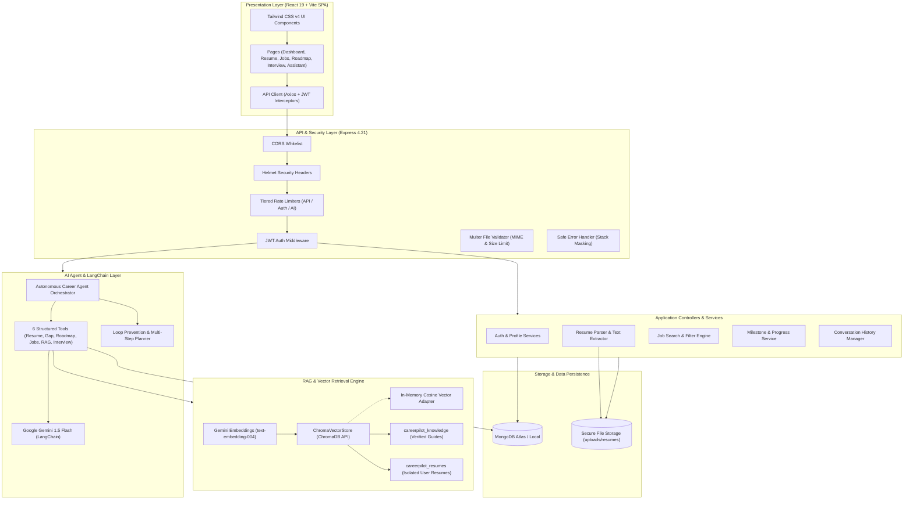
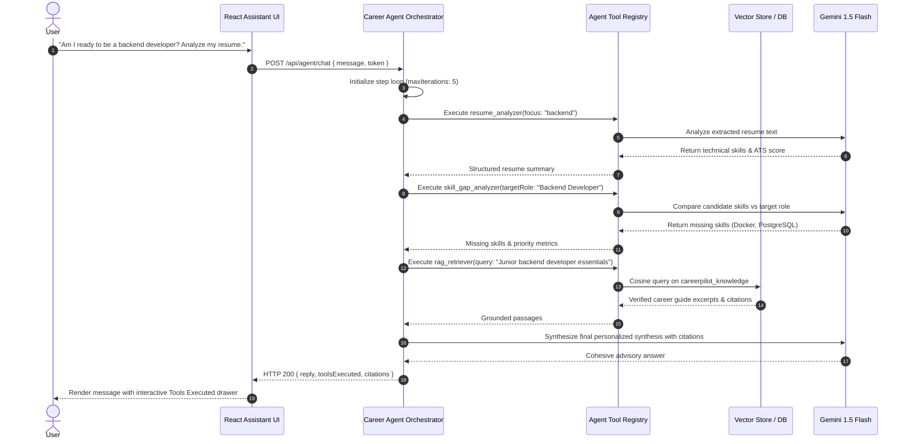
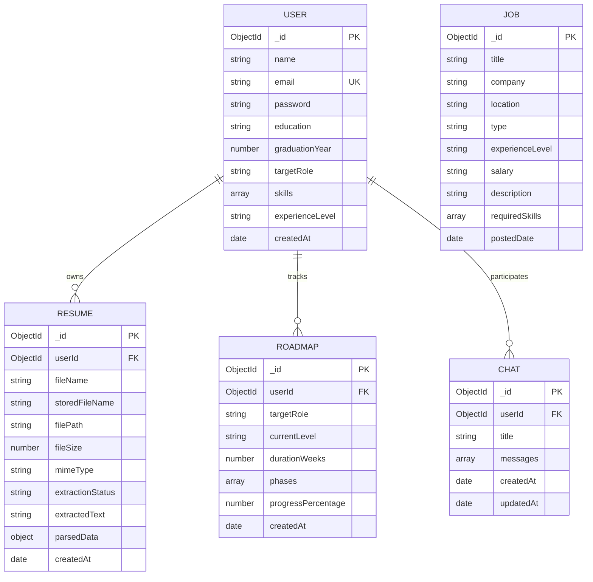

# CareerPilot – System Architecture

This document describes the high-level system architecture, design decisions, data flow, AI agent orchestration, and security mechanisms powering **CareerPilot – Your AI Career Copilot**.

---

## 1. High-Level Architecture

CareerPilot is organized as a decoupled, full-stack micro-modular system with an autonomous AI Agent and Retrieval-Augmented Generation (RAG) vector engine.



---

## 2. Layered Component Architecture

### 2.1 Presentation Layer (`/src`)
- **React 19 & Vite 8**: Extremely fast Hot Module Replacement (HMR) and optimized Rollup/Rolldown production bundling with manual chunk splitting.
- **Tailwind CSS v4**: Utility-first responsive styling utilizing modern CSS variables and container queries.
- **Lucide React**: Scalable SVG icon system across all navigation, status badges, and tool output inspectors.
- **React Router DOM 7**: Client-side routing with route guards, preserving navigation state and scroll positions.
- **API Interceptor Engine**: `src/services/api.js` provides automatic Bearer token injection, request timeouts, and structured error propagation.

### 2.2 API Gateway & Middleware Layer (`server/src/middleware`)
1. **Security Headers (`helmet`)**: Configures Content-Security-Policy, Frameguard (`DENY`), and Cross-Origin Resource Policies.
2. **Tiered Rate Limiting (`express-rate-limit`)**:
   - `apiLimiter`: 300 requests / 15 minutes for read operations.
   - `authLimiter`: 40 requests / 15 minutes to thwart brute-force password guessing.
   - `aiLimiter`: 80 requests / 15 minutes to govern Gemini API quotas.
3. **Authentication Middleware (`authMiddleware.js`)**: Decodes and verifies HS256 JWT tokens, validating user existence and injecting the sanitized `req.user` payload into downstream handlers.
4. **File Sandboxing (`uploadMiddleware.js`)**: Restricts uploads strictly to `.pdf`, `.docx`, and `.doc` formats, enforcing a 5MB size limit and generating cryptographically randomized filenames (`crypto.randomUUID()`) to prevent directory traversal attacks.
5. **Safe Error Masking (`errorMiddleware.js`)**: Traps unhandled rejections, converts Mongoose validation errors into structured 400 responses, and conceals internal stack traces in `production` mode.

### 2.3 AI Agent Orchestration (`server/src/services/agent`)
The career assistant operates as an autonomous agent utilizing **LangChain.js** structured tool calling:



#### Loop Prevention & Guardrails
- **`maxIterations: 5`**: Hard limit preventing infinite agent execution cycles or runaway token consumption.
- **Tool Result Memoization**: Prevents duplicate tool invocations within the same user turn.
- **Deterministic Fallback Planner**: If LangChain tool calling reaches max iterations or encounters an unparseable response, a deterministic multi-stage planner fulfills the request reliably.

---

## 3. RAG Pipeline & Vector Storage Architecture

### 3.1 Collections & Embeddings
CareerPilot segments knowledge into two collections:
1. `careerpilot_knowledge`: Verified industry guides, career roadmaps, and interview guidelines.
2. `careerpilot_resumes`: Chunks derived from user resumes, strictly partitioned by `userId`.

### 3.2 Dual Vector Engine (ChromaDB + In-Memory Fallback)
To ensure continuous availability in all environments (local, Docker, or serverless):
- **Primary Engine**: ChromaDB HTTP client connecting to `CHROMA_URL` (`http://localhost:8000`).
- **Resilient Fallback**: If ChromaDB is offline, `ChromaVectorStore` automatically transitions to an in-memory vector collection executing exact cosine similarity calculations over normalized Gemini vector embeddings (`text-embedding-004`).

### 3.3 Privacy & Data Isolation Guarantees
CareerPilot guarantees multi-tenant data isolation:
- Resumes are indexed with metadata: `{ userId: "<mongo_user_id>", resumeId: "<mongo_resume_id>" }`.
- All RAG queries on the resume collection enforce a mandatory metadata filter:
  ```javascript
  where: { userId: user._id.toString() }
  ```
- **Automated Verification**: Suite tests verify that User A cannot retrieve User B's resume chunks under any circumstances, even when spoofing target resume IDs.

---

## 4. Database Schema Design (MongoDB)



---

## 5. Performance & Build Optimizations

1. **Frontend Asset Code-Splitting**:
   - `vite.config.js` splits vendor dependencies into distinct chunks (`vendor-react`, `vendor-axios`, `vendor-misc`), ensuring no single bundle exceeds 300kB.
   - Total compressed frontend bundle: **~149 kB gzipped**.
2. **Database Indexing**:
   - `User.email`: Unique index for $O(1)$ lookups during authentication.
   - `Resume.userId`: Index for instantaneous resume list queries.
   - `Job.title` & `Job.requiredSkills`: Text index for fast multi-field search.
3. **Payload Sanitization**:
   - Resume extraction ignores images and embedded binaries, preserving only textual content to minimize memory footprint.
